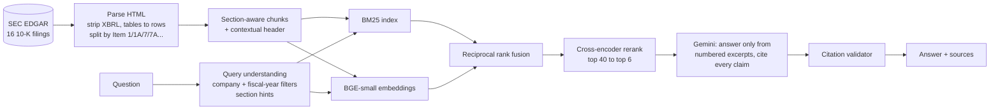

# 10-K Analyst: RAG over SEC Filings, with an Evaluation Harness

[](https://github.com/VishalMankala/sec-filings-rag/actions/workflows/ci.yml)
[](https://github.com/VishalMankala/sec-filings-rag/actions/workflows/eval.yml)


Ask questions about the annual reports (Form 10-K) of Apple, Microsoft, NVIDIA, Amazon, Alphabet, Meta,
Tesla and Netflix, and get **answers that cite the exact filing section**, or an honest "not in the
filings". The difference from a typical RAG demo is that **it is measured**. A 47-question evaluation set
scores retrieval on every push, an ablation shows what each component adds, and generated answers are
checked for faithfulness, citation validity and correct refusals.



## Results

> Retrieval numbers come from the **RAG evaluation** workflow, which runs on every push to `main` and needs no API key.
> Generation numbers need a free Gemini key added as the `GEMINI_API_KEY` repository secret. To be filled in from those runs.

| Retrieval mode | Recall@6 | Hit@1 | MRR |
|---|---:|---:|---:|
| BM25 only | _pending_ | | |
| Dense only (BGE-small) | _pending_ | | |
| Hybrid (RRF) | _pending_ | | |
| Hybrid + cross-encoder rerank | _pending_ | | |

| Generation metric | Value |
|---|---:|
| Faithfulness (claims supported by the excerpts) | _pending_ |
| Correct refusal rate (unanswerable questions) | _pending_ |
| Citation validity | _pending_ |

## What's inside

**Ingestion that respects 10-K structure.** Filings are pulled from EDGAR's free API (rate-limited, cached).
The parser strips inline-XBRL metadata and hidden elements, flattens tables into `label | value | value`
rows so numbers keep their labels, and splits each filing into Items (1 Business, 1A Risk Factors, 1C
Cybersecurity, 7 MD&A, 7A Market Risk, …). The table of contents repeats every heading, so for each Item
the parser keeps the occurrence that starts the longest section.

**Chunks that know where they came from.** Chunks never cross an Item boundary. Each one is embedded with a
header such as `Apple Inc. (AAPL) | FY2025 10-K | Item 1A Risk Factors`, so generic text like "supply
constraints" is tied to the right company and section.

**Hybrid retrieval with query understanding.**
- BM25 catches exact terms (tickers, "Item 7A", product names, numbers). Dense embeddings catch meaning.
- The two rankings are merged with **reciprocal rank fusion**, which is robust to their incompatible
  score scales.
- Company names and fiscal years in the question become **metadata filters**. "Compare Meta and
  Alphabet" searches only those two companies.
- A **cross-encoder** reranks the top 40 down to 6.

**Grounded generation.** Gemini is told to use only the numbered excerpts, cite every factual sentence,
quote numbers exactly, and say *"I can't find this in the indexed 10-K filings."* when the answer isn't
there. Every response is checked afterwards: citations that point to non-existent sources and factual
sentences without a citation are flagged in the API response and the UI.

**Evaluation harness** (`eval/questions.jsonl`, `src/secrag/evaluate.py`):
- 41 answerable questions labelled with the company and the 10-K Item that should contain the answer
  (single-company, and 4 comparisons across two companies), plus 6 unanswerable questions.
- **Retrieval**: recall@6, hit@1 and MRR for each retrieval mode (ablation). The CI gate fails if recall drops.
- **Generation**: an LLM judge lists each claim in the answer and checks it against the excerpts only
  (faithfulness). It also scores answer relevance, plus correct-refusal rate, citation validity and latency.

## Quickstart

```bash
make install
export GEMINI_API_KEY=...          # free: https://aistudio.google.com/apikey
make ingest                        # ~16 filings from EDGAR -> data/index
secrag ask "What does NVIDIA say about U.S. export controls?"
make eval-retrieval                # no key needed
make serve                         # API: http://localhost:8000/docs
make ui                            # Streamlit: http://localhost:8501
```

Docker: `docker compose run --rm ingest && docker compose up -d api ui`.

```bash
curl -s localhost:8000/ask -H 'Content-Type: application/json' \
  -d '{"question": "Compare how Apple and Microsoft describe their cybersecurity governance."}'
```

Returns `answer`, `refused`, `citations_valid`, `uncited_sentences`, and `sources` (ticker, fiscal year,
Item, EDGAR link, snippet). `POST /search` returns the retrieved chunks for any mode (`bm25`, `dense`,
`hybrid`, `hybrid_rerank`).

## Project layout

```
src/secrag/
  edgar.py      EDGAR client: ticker -> CIK -> latest 10-Ks, polite rate limiting, cache
  parse.py      HTML -> clean text -> Items (handles XBRL, tables, table of contents)
  chunk.py      section-aware chunks with contextual headers
  index.py      BM25 + vector index, save/load
  retrieve.py   filters, hybrid search, RRF, reranking
  generate.py   prompt, Gemini client, citation checks, refusals
  evaluate.py   retrieval ablation + LLM-judged generation eval
  api.py        FastAPI    ·  app.py: Streamlit UI
eval/questions.jsonl   47 labelled questions
tests/                 20 offline tests (fixture 10-Ks, fake LLM): parsing, chunking, retrieval, citations, eval, API
```

Design decisions: [docs/DESIGN.md](docs/DESIGN.md).
